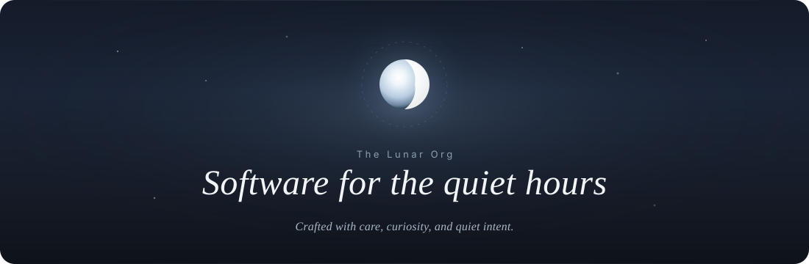

<p align="center">
  
</p>

<p align="center">
  <em>Quiet craftsmanship, purposeful code, and software built to endure.</em>
</p>

<p align="center">
  <a href="https://github.com/ItsHimanshu-Raj"></a>
  <a href="https://x.com/1tsRaj"></a>
  <a href="https://instagram.com/1tsraj"></a>
  
</p>

---

### ✦ The Ethos

**The Lunar Org** is an independent studio and engineering collective. We craft tools we depend on ourselves, explore robust architectures, and design software with intentional restraint.

> *"Perfection is achieved, not when there is nothing more to add, but when there is nothing left to take away."*

- **Intentional Restraint** — We reject bloat, unnecessary dependencies, and surveillance telemetry.
- **Quiet Utility** — Tools designed to work quietly in the background, surfacing only when meaningful signal is present.
- **Deep Exploration** — Continuous experimentation across systems programming, automation, and privacy-preserving primitives.

---

### 🌑 Ecosystem & Repositories

| Project | Description | Stack | Status |
| :--- | :--- | :--- | :--- |
| [**lunar-bot**](https://github.com/The-Lunar-Org/lunar-bot) | Autonomous telemetry, GitHub webhooks, and operations pipeline for Discord. | `Python` `Discord.py` `aiohttp` `Docker` | `Active` |
| [**.github**](https://github.com/The-Lunar-Org/.github) | Organization-wide standards, security protocols, and community health definitions. | `Markdown` `YAML` | `Stable` |

---

### ⚙️ Core Principles

```text
  01. Signal > Noise          Every feature must justify its existence.
  02. Deterministic           Predictable states, transparent logs, and clean failures.
  03. Respectful              No non-consensual tracking or dark patterns.
  04. Evergreen               Built using foundational tools that last years, not weeks.
```

---

### 🛡️ Standards & Governance

Our collective maintains unified community health standards across all repositories:

- 📋 [**Contributing Guidelines**](CONTRIBUTING.md) — How we collaborate, format commits, and test changes.
- 🔒 [**Security Policy**](SECURITY.md) — Responsible vulnerability disclosure guidelines.
- 🤝 [**Code of Conduct**](CODE_OF_CONDUCT.md) — Fostering an inclusive, respectful environment.

---

<p align="center">
  <sub>✦ <b>The Lunar Org</b> — Built with calm & precision. ✦</sub>
</p>
